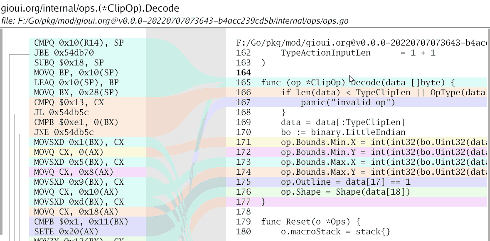

# lensm

A tool for viewing assembly and source.



Install with the usual Go commands:

```
go install loov.dev/lensm@main
```

_For Linux you may need to add some [additional dependencies](https://gioui.org/doc/install/linux). You can use `go install --tags nowayland loov.dev/lensm@main` or `go install --tags nox11 loov.dev/lensm@main` respectively to skip building Wayland or X11 version._

Build this checkout locally:

```
go build -o lensm .
```

GitHub Actions also builds installable macOS disk images for Apple Silicon
and Intel. Download the DMG artifact from a successful CI run, open it, and
drag `Lensm.app` to Applications. CI builds use an ad-hoc signature, so macOS
may require the first launch through **Control-click → Open**.

To build the DMG locally on macOS:

```
./scripts/build-macos-dmg.sh 0.0.0 1 "$(go env GOARCH)"
```

On Linux, use the same Gio tags if you want to skip a windowing backend:

```
go build -tags nowayland -o lensm .
go build -tags nox11 -o lensm .
```

Run the program with an executable path, or start it without arguments
and load an executable from the top bar. On macOS, use Choose... to select
the executable with the native Finder file dialog. The function filter is
available inside the UI. `-watch` allows to automatically reload the
executable and information when it changes.

```
lensm -watch lensm
```

Flags:

| Flag | Meaning |
|------|---------|
| `-watch` | reload the binary when it changes |
| `-filter regexp` | start with the function list filtered |
| `-context n` | source lines shown around each referenced line (default 3) |
| `-comments path` | comments file, instead of `<executable>.lensm-comments.json` |
| `-text-size n` | text size for this run; Settings saves one for later runs |
| `-font path` | font file to use instead of the bundled ones |
| `-profile path` | show a pprof profile of the binary next to the code |
| `-cpuprofile path` | write a CPU profile of lensm itself |

Keys:

- `Cmd/Ctrl+F` in the code finds text in the shown columns of the open
  function; `Enter` or `Cmd/Ctrl+G` steps to the next match, with `Shift`
  to the previous, and `Escape` closes the find bar;
- `Cmd/Ctrl+F` elsewhere focuses the function filter; `Down` or `Enter` moves into the
  list, and `Enter` there keeps the previewed function open in a tab;
- `Cmd/Ctrl+P` goes to a function by name, or by an address such as
  `0x4a2f10` from a stack trace or profile, selecting its instruction;
- `?` lists the keyboard shortcuts;
- `Cmd/Ctrl+O` opens a binary and `Cmd/Ctrl+,` opens settings;
- `Ctrl+Tab` and `Ctrl+Shift+Tab` switch tabs, `Cmd/Ctrl+W` closes one;
- follow call targets and use `Alt+Left/Right` (or `Cmd/Ctrl+[` and
  `Cmd/Ctrl+]`) to navigate between functions;
- in the code, `Up`/`Down`, `Page Up`/`Page Down` and `Home`/`End` move
  between instructions or source lines, with `Shift` to extend a
  selection, and `Tab` moves to the counterpart in the other column. In
  the assembly `Right` follows a jump or call and `Left` returns from a
  followed jump;
- hover an assembly instruction to see its reference and a simplified
  explanation when Lensm has a matching rule;
- drag across Go assembly, native assembly, or source lines to select a block,
  then use `Cmd/Ctrl+C` to copy it. `Shift` extends a selection and
  `Escape` clears it;
- right-click an instruction to scroll its source line beside it, or a
  source line to scroll its instructions beside it; when the line
  compiled into several runs of instructions, each right-click steps to
  the next run;
- the Callers panel in the sidebar lists the functions that call the
  open one; click one to open it. The Summary panel lists every
  function by size, spills, bounds checks, allocations or write
  barriers, largest first;
- open a pprof profile of the binary with Open Profile… in the menu, or
  `-profile`, to see each instruction's and source line's share of the
  samples in a lane beside them (click the profile in the status bar to
  pick which of its values to show, such as allocated bytes instead of
  in-use ones; each binary remembers its profile, and with Watch on a
  rewritten profile reloads), and to rank functions by samples in
  the Summary panel. A call's row shows the time spent below it, marked
  ↳, and a source line counts the time in its calls too, as pprof's
  list does. With a profile the Callers panel puts the callers that
  spend the most through the open function first, and the Call graph
  panel draws the hottest callers and callees around it; click a
  function in the graph to open it. The first button on the right edge,
  or Profile Graph in the menu, draws the whole profile's graph in a
  resizable pane right of the code, as pprof's web view does, with a node's text growing with
  its own time. Drag or scroll to pan, and hold Command or Ctrl and
  scroll to zoom. Above it, find functions by name (Enter steps
  through them), focus on the stacks through the open function, hide
  the runtime so its time counts in the code calling it, and pick the
  least share a function needs to be drawn. The second button on the
  right edge draws a flame graph of the same samples instead, callers
  on top; click a frame to zoom to it and open its function, and a
  frame above to zoom out. Hold Command or Ctrl and scroll to zoom
  about the pointer, and drag or scroll to pan.
  Compare Profile With… in
  the menu loads a profile to compare with, from this build or another,
  and the graphs then show the change from it by function name, as
  pprof's -diff_base does: red where time grew, green where it shrank. The button at the end lets
  it fill the window. The profile's addresses are matched
  to the binary by function, so a profile of a position independent
  binary works;
- Compare With… in the menu loads another build of the program and
  shows the open function from both side by side, with the instructions
  aligned and the removed and added ones marked. Addresses and branch
  distances, which shift whenever code moves, don't count as changes;
- turn on "Sync scroll" in the status bar to scroll the assembly and the
  source together;
- double-click a line, or press `Enter` on a selected one, to comment on it;
  `Escape` leaves the comment.

Run lensm as an MCP server over stdio:

```
lensm mcp [-comments ./lensm.lensm-comments.json] ./lensm
```

Flags go before the path: `lensm mcp ./lensm -comments x` is a usage error.

The MCP server exposes tools for listing functions, reading a function's
source with its assembly in Go and native syntax, and reading or writing
comments. `get_function` returns 500 instructions at a time; `views`,
`offset` and `limit` select what comes back. By default comments are stored
in a sidecar file named `<executable>.lensm-comments.json`.

The GUI can also serve MCP over HTTP: Settings starts a server at
`http://127.0.0.1:7077/mcp` (or another free port if that one is taken) for
the binary that is open, and it follows whatever the window loads. It only
listens on loopback and refuses requests from web pages, but it has no
authentication, so any program running as any user on the machine can read
the code and write comments while it runs.

When the GUI and a separate `lensm mcp` process write the same sidecar,
saves merge per comment: each process's additions, edits, and deletions
survive, and only conflicting edits to the same comment resolve to the
last writer. The merge is read-then-write without a file lock, so two
saves landing in the same instant can still lose one side's changes.
Comments are keyed by function name, not by binary: point `-comments` at
one shared file only for builds of the same program.

Binaries from other compilers work too. Functions come from the symbol
table and source from DWARF, so a C or C++ program built with `-g` shows
its source alongside the assembly; on macOS the debug info lives in the
`.dSYM` bundle next to the binary, which is read automatically. C++ and
Rust symbols are demangled — for C++ the signature is kept, so overloads
stay apart. A function is listed under the file it was written in, which
for heavily inlined code is not the file its first instruction belongs to.

Note: The program requires a binary that is built on your computer, otherwise the source code for the functions cannot be loaded.

WebAssembly modules (`GOOS=wasip1 GOARCH=wasm`, TinyGo, or any `.wasm`) are
recognised by their magic bytes and shown as WAT, one instruction per line
with calls resolved to function names. Source comes from whichever line
table the module carries. Go embeds a pclntab in its data segments, which
records a position per resume point rather than per instruction, so a run
of instructions between two resume points shares one line. TinyGo and
clang emit DWARF instead, which is per statement. All of TinyGo's wasm
targets work. A `wasip2` build is a component rather than a plain module,
so its functions come from the core modules nested inside it and are
listed under the module they belong to, as in `main/main.sumInts`.

Microcontroller builds work too. TinyGo's Cortex-M targets (`pico`, `pico2`,
`feather-m4`, `teensy40`, ...) produce Thumb code, which is decoded by a
disassembler generated from ARM's architecture reference XML — Thumb-1,
Thumb-2 and the floating-point extension, IT blocks included, with branch
targets resolved to function names and the literal pools inside functions
shown as `.word` data. 32-bit RISC-V targets such as the ESP32-C3 are
decoded with the RISC-V decoder; AVR (`arduino`, `attiny`, ...) and Xtensa
(`esp32-*`, `nodemcu`, `d1mini`) by decoders of their own, in the syntax
of the GNU objdump for each.

## Why?

I wrote a blog post at https://www.storj.io/blog/lensm on why and how the core functionality works.
