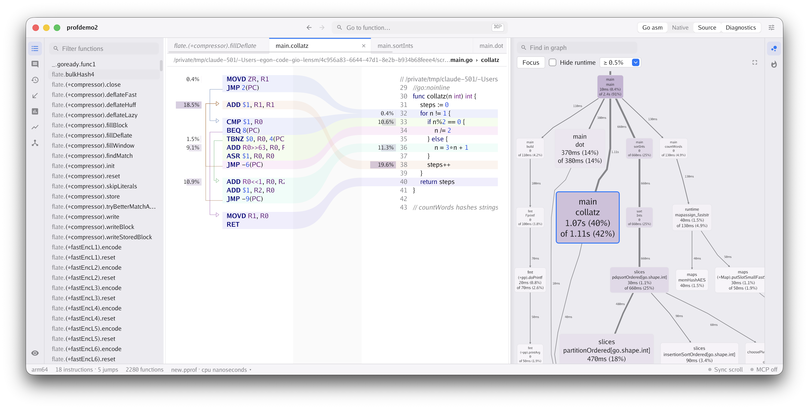

# lensm

A tool for viewing assembly and source side by side.



I wrote a [blog post](https://www.storj.io/blog/lensm) on why and how the
core of it works.

## Install

```
go install loov.dev/lensm@main
```

On Linux you may need some [additional
dependencies](https://gioui.org/doc/install/linux). Add `-tags nowayland`
or `-tags nox11` to skip building the Wayland or X11 backend.

To build this checkout:

```
go build -o lensm .
```

GitHub Actions builds macOS disk images for Apple Silicon and Intel.
Download the DMG artifact from a CI run, open it and drag `Lensm.app` to
Applications. The builds have an ad-hoc signature, so the first launch
may need Control-click, Open. To build the DMG yourself:

```
./scripts/build-macos-dmg.sh 0.0.0 1 "$(go env GOARCH)"
```

## Usage

Pass the binary on the command line, or start lensm without arguments
and open one from the toolbar.

```
lensm -watch lensm
```

The binary has to be built on your machine, otherwise lensm can't find
the source files.

| Flag | Meaning |
|------|---------|
| `-watch` | reload the binary when it changes |
| `-filter regexp` | start with the function list filtered |
| `-context n` | source lines shown around each referenced line (default 3) |
| `-comments path` | comments file, instead of `<executable>.lensm-comments.json` |
| `-text-size n` | text size for this run; Settings saves one for later runs |
| `-font path` | font file to use instead of the bundled ones |
| `-profile path` | show a pprof profile of the binary next to the code |
| `-cpuprofile path` | write a CPU profile of lensm itself |

## Keys

`Cmd` is `Ctrl` outside macOS. `?` in the app lists all of them.

| Key | Action |
|-----|--------|
| `Cmd+P` | go to a function by name, or by an address such as `0x4a2f10` |
| `Cmd+F` | in the code, find in the open function; elsewhere, filter the function list |
| `Down`, `Enter` | from the filter, move into the function list; `Enter` there keeps the previewed function open |
| `Enter`, `Cmd+G` | next match, with `Shift` the previous |
| `Cmd+O` | open a binary |
| `Cmd+,` | settings |
| `Cmd+B` | show or hide the sidebar |
| `Ctrl+Tab`, `Ctrl+Shift+Tab` | next and previous tab |
| `Cmd+W` | close the tab |
| `Alt+Left`, `Alt+Right` | back and forward between functions, also `Cmd+[` and `Cmd+]` |
| `Up`, `Down`, `Page Up`, `Page Down`, `Home`, `End` | move between instructions or source lines, with `Shift` to select |
| `Tab` | move to the matching line in the other column |
| `Right`, `Left` | follow a jump or call, and come back |
| `Cmd+C` | copy the selection |
| `Enter` | comment on the selected line |
| `Escape` | close the find bar, clear the selection or leave a comment |

Double-click a line to comment on it. Right-click an instruction to
bring its source line beside it, or a source line to bring its
instructions; when a line compiled into several runs, each right-click
steps to the next.

## Profiles

Open a pprof profile with Open Profile in the menu or `-profile`, and
each instruction and source line shows its share of the samples. The
buttons on the right edge show the whole profile as a call graph or a
flame graph. Compare Profile With loads a second profile and shows the
change, red where time grew and green where it shrank.

In the graphs, drag or scroll to pan and hold `Cmd` and scroll to zoom.
In the flame graph, click a frame to zoom to it, double-click or
`Cmd`-click to open its function, and press `Escape` to zoom out.

## Comparing builds

Compare With in the menu loads another build of the program and shows
the open function from both side by side. The instructions are aligned
and the removed and added ones marked. Addresses and branch distances
don't count as changes, since they shift whenever code moves.

## MCP

Run lensm as an MCP server over stdio:

```
lensm mcp [-comments ./lensm.lensm-comments.json] ./lensm
```

Flags go before the path.

The server has tools to list functions, read a function's source with
its Go and native assembly, and read and write comments. `get_function`
returns 500 instructions at a time, and `views`, `offset` and `limit`
pick what comes back.

The app can serve MCP over HTTP too. Settings starts a server at
`http://127.0.0.1:7077/mcp`, or another port if that one is taken, for
the binary that is open. It listens only on loopback and refuses
requests from web pages, but it has no authentication: any program on
the machine can read the code and write comments while it runs.

Comments are saved next to the binary in
`<executable>.lensm-comments.json`, keyed by function name. When the app
and `lensm mcp` save the same file, each keeps the other's changes, and
only two edits of the same comment go to the last writer. The merge takes
no lock, so two saves at the same instant can still lose one side.
Share one comments file only between builds of the same program.

## Other compilers

Functions come from the symbol table and source from DWARF, so a C, C++
or Rust program built with `-g` shows its source too. On macOS lensm
reads the debug info from the `.dSYM` bundle next to the binary. C++ and
Rust names are demangled, and C++ keeps the signature so overloads stay
apart. A function is listed under the file it was written in, which for
inlined code isn't always the file of its first instruction.

### WebAssembly

Modules from `GOOS=wasip1 GOARCH=wasm`, TinyGo or anything else are shown
as WAT, with calls resolved to function names and branches drawn as
jumps. The Statements column spells the same code as expressions, such
as `l2 = i32[p0 + l1] + l2`, each on the row of the instruction that
completes it.

- Go records a source position per resume point, not per instruction, so
  the instructions between two resume points share one line.
- TinyGo and clang write DWARF, which is per statement. All of TinyGo's
  wasm targets work.
- A `wasip2` build is a component; its functions are listed under the
  core module they belong to, as in `main/main.sumInts`.

### Microcontrollers

- TinyGo's Cortex-M targets (`pico`, `pico2`, `feather-m4`, `teensy40`,
  ...) are Thumb code. The decoder is generated from ARM's architecture
  reference and covers Thumb-1, Thumb-2, IT blocks and floating point.
  Literal pools show as `.word` data.
- 32-bit RISC-V targets, such as the ESP32-C3, use the RISC-V decoder.
- AVR (`arduino`, `attiny`, ...) and Xtensa (`esp32-*`, `nodemcu`,
  `d1mini`) have decoders of their own, in GNU objdump's syntax.
